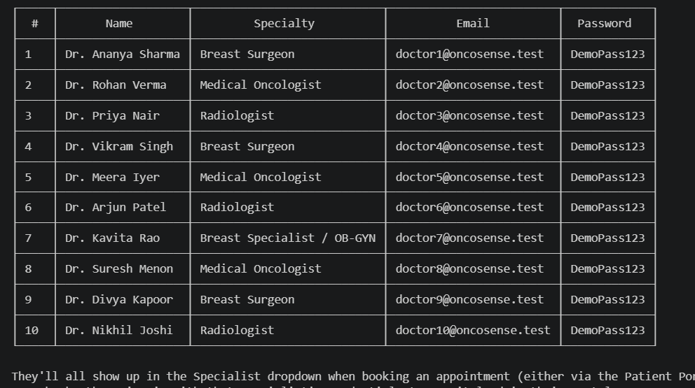

# Breast Cancer Detection (Major Project)

| Project Overview | Dashboard Preview |
| --- | --- |
| Image-based breast cancer classification using deep learning, supporting three interchangeable datasets: CBIS-DDSM, IDC, and BreakHis. Designed for mammogram analysis, patient-wise data splitting, and explainable AI for clinical interpretation. |  |

Image-based breast cancer classification using deep learning, supporting three
interchangeable datasets:

- **CBIS-DDSM** (full mammograms, DICOM) — benign vs malignant, from TCIA +
  case-description CSVs. This is the dataset actually being used in this
  project (see below).
- **IDC** (Breast Histopathology Images) — 277,524 50x50 patches, IDC-positive
  vs IDC-negative. Reference: [sayakpaul/Breast-Cancer-Detection-using-Deep-Learning](https://github.com/sayakpaul/Breast-Cancer-Detection-using-Deep-Learning)
- **BreakHis** — 7,909 microscope images at 40x/100x/200x/400x magnification,
  benign vs malignant (with tumor subtypes).

Everything is driven by a YAML config (`configs/cbis_ddsm.yaml`,
`configs/idc.yaml`, or `configs/breakhis.yaml`) so switching datasets doesn't
require touching code.

## Project layout

```
configs/            YAML configs (dataset paths, model choice, hyperparameters)
data/raw/            Downloaded Kaggle datasets go here (gitignored)
data/processed/      Patient-wise train/val/test splits (gitignored, generated)
src/
  datasets.py        ImageFolder loaders + transforms + class-weight helper
  prepare_cbis_ddsm.py Joins TCIA DICOMs + case CSVs into benign/malignant PNGs, patient-wise split
  prepare_cbis_ddsm_roi.py Same, but from ROI-cropped lesion patches instead of full mammograms (easier task, higher accuracy -- see below)
  prepare_idc.py      Splits raw IDC dataset by PATIENT into train/val/test
  prepare_breakhis.py Splits raw BreakHis dataset by PATIENT into train/val/test
  model.py            SimpleCNN (from scratch) + ResNet18/EfficientNet-B0 (transfer learning)
  train.py            Training loop, early stopping, best-checkpoint saving
  evaluate.py         Test-set metrics: accuracy, F1, ROC-AUC, confusion matrix
  gradcam.py           Grad-CAM heatmaps for interpretability (good for the report/viva)
  quality.py           Mammogram quality checker: detects corrupted, blurred, or unsuitable inputs
  utils.py             Seeding, checkpoint I/O, running-average helper
outputs/             Checkpoints, training logs (CSV), Grad-CAM images (gitignored)
```

## Why split by patient, not by image

Both IDC and BreakHis contain many patches/images per patient. If you split
by image, patches from the same patient end up in both train and test, and
the model partly memorizes patient-specific tissue texture instead of
learning the general benign/malignant pattern — accuracy looks great but is
inflated. `prepare_idc.py` and `prepare_breakhis.py` both split at the
patient level to avoid this leakage. Mention this explicitly in your report —
it's a common flaw examiners look for.

## Setup

```bash
python -m venv .venv
.venv\Scripts\activate        # Windows
pip install -r requirements.txt

# If you have an NVIDIA GPU (recommended -- training on CPU is much slower),
# install the CUDA build of torch instead of the default CPU-only wheel:
pip install torch torchvision --index-url https://download.pytorch.org/whl/cu130
```

## Run the web app

From the repository root, start Streamlit with the project environment:

```powershell
.\.venv\Scripts\python.exe -m streamlit run app.py
```

Using the environment's Python explicitly avoids starting a different global
Streamlit version, whose frontend assets may not match the ones cached by the
browser. After changing Streamlit versions, restart the server and hard-refresh
the browser (`Ctrl+Shift+R`).

## 1. Get a dataset

### CBIS-DDSM (what this project is currently set up to use)

CBIS-DDSM ships as two separate pieces you have to join yourself:

1. **DICOM images**, downloaded per-collection via the TCIA Data Retriever
   from a `.tcia` manifest file (`Mass-Training_full_mammogram_images.tcia`,
   `Mass-Test_full_mammogram_images.tcia`,
   `Calc-Training_full_mammogram_images.tcia`,
   `Calc-Test_full_mammogram_images.tcia` — download each manifest from the
   [CBIS-DDSM TCIA page](https://www.cancerimagingarchive.net/collection/cbis-ddsm/)
   and open it with `TCIA_Data_Retriever.exe`). Each image lands in its own
   folder, e.g. `cbis_ddsm/Mass-Training_P_00001_LEFT_CC/<StudyUID>/<SeriesUID>/*.dcm`.
2. **Case description CSVs** (`mass_case_description_{train,test}_set.csv`,
   `calc_case_description_{train,test}_set.csv`) with the benign/malignant
   `pathology` label for each image.

`prepare_cbis_ddsm.py` joins these: it reads the CSVs, finds the matching
downloaded DICOM for each row, converts it to an 8-bit PNG (with
MONOCHROME1 inversion handled, black-padded to square so resizing doesn't
distort mass/calcification shapes), and writes `benign`/`malignant` folders.
If a row's abnormality appears twice with different labels within the same
image, malignant wins for the whole-image label.

It's safe to run with a **partial download** — currently only the
Mass-Training full mammograms have been downloaded (1,231 images). Rows
without a downloaded DICOM are skipped and counted, not treated as an error:

```bash
python src/prepare_cbis_ddsm.py \
  --dicom-root "D:\TCIA_Data_Retriever_windows_amd64\cbis_ddsm" \
  --train-csvs "C:\Users\HP\Downloads\mass_case_description_train_set.csv" \
  --out-dir data/processed/cbis_ddsm
```

This carves train/val (patient-wise, 85/15) out of the 1,231 Mass-Training
images you already have, so you can start training today. `test/` is left
empty until you download the official test-set manifests.

**Before reporting final numbers**, download `Mass-Test_full_mammogram_images.tcia`
and (optionally, for more data) `Calc-Training_full_mammogram_images.tcia` +
`Calc-Test_full_mammogram_images.tcia` via the TCIA Data Retriever, then
re-run with both CSV lists so test uses the real official CBIS-DDSM test
split (keeps your numbers comparable to published papers):

```bash
python src/prepare_cbis_ddsm.py \
  --dicom-root "D:\TCIA_Data_Retriever_windows_amd64\cbis_ddsm" \
  --train-csvs "C:\Users\HP\Downloads\mass_case_description_train_set.csv" "C:\Users\HP\Downloads\calc_case_description_train_set.csv" \
  --test-csvs  "C:\Users\HP\Downloads\mass_case_description_test_set.csv" "C:\Users\HP\Downloads\calc_case_description_test_set.csv" \
  --out-dir data/processed/cbis_ddsm
```

### CBIS-DDSM, ROI-cropped lesion patches (higher accuracy, recommended)

Full-mammogram classification (above) tops out around 65-75% accuracy because
the model has to both find and classify a small lesion in a huge downsampled
image. Classifying the lesion patch CBIS-DDSM already provides is an easier
task and reaches somewhat higher accuracy -- see the data-quality note below
before expecting too much from this, though.

Can be downloaded the same fast way as the full mammograms (see
`src/fast_download_roi_series.py`, no TCIA GUI needed) -- or via the TCIA
Data Retriever manifests `Mass-Training_ROI_and_cropped_images.tcia`,
`Mass-Test_ROI_and_cropped_images.tcia`, `Calc-Training_ROI_and_cropped_images.tcia`,
`Calc-Test_ROI_and_cropped_images.tcia` from the
[CBIS-DDSM TCIA page](https://www.cancerimagingarchive.net/collection/cbis-ddsm/),
pointed at the same `--dicom-root` folder you already used (folder names
don't collide with the full-mammogram download).

```bash
python src/fast_download_roi_series.py --dicom-root "D:\TCIA_Data_Retriever_windows_amd64\cbis_ddsm"

python src/prepare_cbis_ddsm_roi.py \
  --dicom-root "D:\TCIA_Data_Retriever_windows_amd64\cbis_ddsm" \
  --train-csvs "C:\Users\HP\Downloads\mass_case_description_train_set.csv" "C:\Users\HP\Downloads\calc_case_description_train_set.csv" \
  --test-csvs  "C:\Users\HP\Downloads\mass_case_description_test_set.csv" "C:\Users\HP\Downloads\calc_case_description_test_set.csv" \
  --out-dir data/processed/cbis_ddsm_roi

python src/train.py --config configs/cbis_ddsm_roi_effnet.yaml
python src/evaluate.py --config configs/cbis_ddsm_roi_effnet.yaml --threshold 0.625
```

**Data-quality quirk that matters a lot here:** CBIS-DDSM's "cropped image"
and "ROI mask" series for a given abnormality are two separate IDC series,
and which SeriesDescription is actually which is *not* reliable -- some
"cropped images" series are secretly the full-mammogram-sized binary mask,
and vice versa. Trusting the label naively resizes a full-resolution binary
blob down to 224x224 for roughly half the dataset, destroying signal and
capping test accuracy around 60% regardless of architecture (this was caught
mid-project -- see git history / ask if you want the before/after numbers
for the report, it's a good "we found and fixed a subtle data leakage bug"
paragraph for a viva). `prepare_cbis_ddsm_roi.py` now validates every
candidate .dcm by actual pixel content (small + textured = real patch;
large + ~binary = mask) and falls back to cropping the lesion's bounding box
directly out of the full mammogram when only the mask is available. Even
after that fix, only a genuinely small, textured patch is used for about
60-70% of abnormalities in the official CBIS-DDSM CSVs -- the rest have
neither a usable crop nor a mask that aligns to the downloaded full image,
and are counted as missing rather than guessed at.

**Honest current numbers** (ResNet18/EfficientNet-B0, patient-wise train/val
split, official CBIS-DDSM test split, threshold tuned on val only):
EfficientNet-B0 reaches test accuracy ~0.70-0.72 and ROC-AUC ~0.78. That's a
real, above-majority-baseline result (majority-class baseline on this test
set is ~0.63), but it has *not* reliably cleared 0.75 test accuracy despite
trying ResNet18 vs EfficientNet-B0, class-weighted vs unweighted loss,
mass-only vs calc-only vs combined training, several seeds, multi-model
ensembling, and TTA. The remaining gap looks data-limited (~1,800 genuinely
usable training patches) rather than a quick architecture fix -- more
usable ROI patches (a full, non-partial IDC/TCIA download may have better
crop/mask coverage) or a stronger domain-pretrained backbone are the most
likely next levers if you need to push past 0.75.

### IDC (Kaggle: `paultimothymooney/breast-histopathology-images`):
```bash
kaggle datasets download -d paultimothymooney/breast-histopathology-images -p data/raw --unzip
# then point --raw-dir at the folder containing <patient_id>/{0,1}/*.png
python src/prepare_idc.py --raw-dir data/raw/IDC_regular_ps50_idx5 --out-dir data/processed/idc
```

### BreakHis (Kaggle: e.g. `ambarish/breakhis`):
```bash
kaggle datasets download -d ambarish/breakhis -p data/raw --unzip
python src/prepare_breakhis.py --raw-dir data/raw/BreaKHis_v1 --out-dir data/processed/breakhis --magnification 40X
```

## 2. Train

```bash
python src/train.py --config configs/cbis_ddsm.yaml
# or
python src/train.py --config configs/idc.yaml
python src/train.py --config configs/breakhis.yaml
```

Logs go to `outputs/logs/<run_name>.csv`, best checkpoint (by validation
ROC-AUC) to `outputs/checkpoints/<run_name>_best.pth`.

## 3. Evaluate on the held-out test set

```bash
python src/evaluate.py --config configs/cbis_ddsm.yaml
```

Prints precision/recall/F1 per class, confusion matrix, and ROC-AUC.

## 4. Grad-CAM (Explainable AI & Interpretability)

Visualizes which mammographic tissue regions influenced ResNet18's prediction, and evaluates whether highlighted areas correspond to annotated parenchymal lesions versus background/scanner artifacts.

> **Research Value & Clinical Caveat:**
> *A heatmap alone does not prove the model is correct.* High classification confidence can arise from shortcut learning (e.g. DICOM text, scanner border lines, chest wall margins). Genuine clinical interpretability requires verifying whether Grad-CAM peak activations localize within authentic parenchymal lesion boundaries.

`ash
# Evaluate test samples with automated tissue alignment and risk scoring
python src/gradcam.py --config configs/cbis_ddsm_v3.yaml --num-samples 8 --target-class auto --evaluate-correspondence

# Single image analysis with custom scientific colormap (turbo, jet, viridis, inferno)
python src/gradcam.py --config configs/cbis_ddsm_v3.yaml --image path/to/mammogram.png --colormap turbo
`

Outputs:
- Side-by-side mammogram + Grad-CAM overlays saved to outputs/gradcam/.
- Quantitative tissue correspondence evaluation CSV saved to outputs/gradcam/gradcam_evaluation_summary.csv.
- Interactive multi-class attribution, thresholding, and lesion alignment tabs directly inside the **OncoSense Screening Workspace** (pages/Screening.py).

## 5. Mammogram Quality Checker

Screen files before inference for corruption, unsuitable dimensions, poor contrast, blur, and insufficient breast tissue coverage:

> **Research Value:**
> Tests whether automated pre-inference quality screening successfully filters unsuitable, corrupted, and degraded inputs, preventing diagnostic errors, false positives, and hallucinations on invalid radiological data.

\\ash
# Check single scan
python src/quality.py --image path/to/mammogram.png

# Run research benchmark evaluating error reduction on corrupted/unsuitable inputs
python src/quality.py --benchmark --dataset-dir data/processed/cbis_ddsm/test
\
## Ideas for making this your own (not just a copy of the reference repo)

- Compare `simple_cnn` vs `resnet18` vs `efficientnet_b0` on the same split
  and report accuracy/AUC/inference-time tradeoffs.
- For CBIS-DDSM: compare mass-only vs mass+calc training data, or try proper
  DICOM windowing (VOI LUT) instead of simple min-max normalization.
- Train BreakHis separately per magnification (40X/100X/200X/400X) and show
  how magnification affects accuracy.
- Add a simple Flask/Streamlit front end that accepts an uploaded image
  and returns a prediction + Grad-CAM overlay.
- Report metrics beyond accuracy (F1, AUC, confusion matrix) — these datasets
  are imbalanced, so accuracy alone is misleading.

